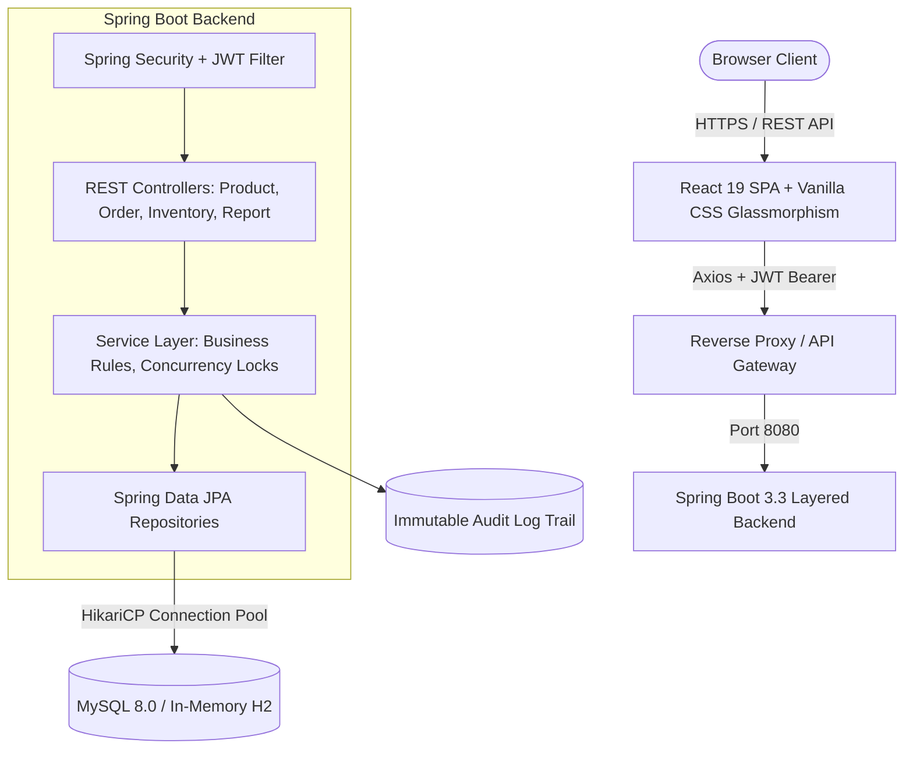
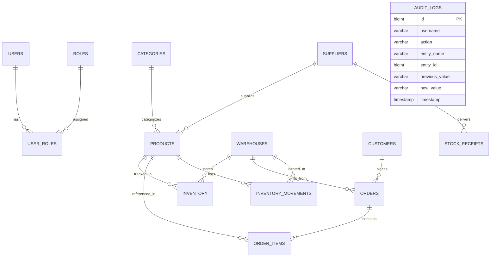

# StockFlow — Enterprise Inventory & Order Management System
**エンタープライズ在庫・受注統合管理システム**

[](https://openjdk.org/)
[](https://spring.io/projects/spring-boot)
[](https://spring.io/projects/spring-security)
[](https://www.mysql.com/)
[](https://react.dev/)
[](https://www.docker.com/)
[](#automated-testing-strategy)

---

## 1. Project Overview / プロジェクト概要

**StockFlow** is a production-grade, full-stack enterprise inventory and order management system built for small-to-medium enterprises (SMEs) managing multi-warehouse logistics, supplier deliveries, customer order pipelines, and real-time stock allocation.

Designed specifically to demonstrate professional software engineering standards for Software Engineer roles in Japan (Web / バックエンド / フルスタックエンジニア), the project emphasizes robust concurrency controls, strict database transaction boundaries (ACID), role-based access control (RBAC), immutable audit trails, and multi-layered testing.

### Key Highlights
- **High Concurrency & Zero Overselling (排他制御・売り越し防止)**: Pessimistic write locking (`SELECT ... FOR UPDATE`) prevents concurrent race conditions and double-allocation when multiple orders claim the same stock simultaneously.
- **Strict Order Lifecycle Finite State Machine (状態遷移モデル)**: Predictable transitions (`CREATED` → `CONFIRMED` → `PROCESSING` → `SHIPPED` → `DELIVERED`), with automated stock restoration upon approved cancellation.
- **Stateless RBAC Security**: JWT-based authentication with granular role-based permissions (`ROLE_ADMIN`, `ROLE_INVENTORY_MANAGER`, `ROLE_SALES_EMPLOYEE`).
- **Immutable Enterprise Audit Logging (監査ログ)**: Automatically records before-and-after state transitions, actors, IP addresses, and timestamps for critical inventory adjustments.
- **Automated Multi-Layer Testing**: Comprehensive JUnit 5 service tests and multi-threaded stress tests simulating concurrent buyers.

---

## 2. System Architecture / システムアーキテクチャ

StockFlow follows an industry-standard layered enterprise architecture:



---

## 3. Concurrency Control & Preventing Overselling / 排他制御と売り越し防止の技術的工夫

### The Problem (同時実行時の課題)
In high-throughput e-commerce and B2B platforms, multiple customers frequently attempt to purchase the final remaining units of an inventory item at the exact same millisecond. Without proper concurrency controls, two concurrent transactions can read `quantityAvailable = 5`, approve two 4-unit orders, and oversell the stock to `-3`.

### The Solution: Pessimistic Locking with ACID Boundaries
StockFlow prevents overselling using database-level pessimistic locking (`PESSIMISTIC_WRITE` translating to SQL `SELECT ... FOR UPDATE`):

```java
// InventoryRepository.java
@Lock(LockModeType.PESSIMISTIC_WRITE)
@Query("SELECT i FROM Inventory i WHERE i.product.id = :productId AND i.warehouse.id = :warehouseId")
Optional<Inventory> findByProductIdAndWarehouseIdForUpdate(
    @Param("productId") Long productId,
    @Param("warehouseId") Long warehouseId
);
```

```java
// InventoryService.java
@Transactional(isolation = Isolation.READ_COMMITTED)
public Inventory deductStockForOrder(Long productId, Long warehouseId, int quantity, String orderNumber) {
    // Row is locked exclusively until the transaction commits or rolls back
    Inventory inventory = inventoryRepository.findByProductIdAndWarehouseIdForUpdate(productId, warehouseId)
        .orElseThrow(() -> new ResourceNotFoundException("Inventory not found"));

    if (inventory.getQuantityAvailable() < quantity) {
        throw new InsufficientStockException("Overselling prevented: Requested " + quantity 
            + " units, but only " + inventory.getQuantityAvailable() + " available.");
    }

    inventory.setQuantityAvailable(inventory.getQuantityAvailable() - quantity);
    recordMovement(inventory, -quantity, MovementType.ORDER_FULFILLMENT, orderNumber);
    return inventoryRepository.save(inventory);
}
```

### Verified by Multi-Threaded Concurrency Test (`InventoryConcurrencyTest.java`)
A multi-threaded JUnit test launches 10 concurrent threads simultaneously requesting stock against a warehouse holding only 20 units. The test guarantees that:
1. Exactly available units are allocated.
2. Excessive requests are cleanly rejected with `InsufficientStockException`.
3. Stock quantity never drops below zero.

---

## 4. Database Schema & ERD / データベース設計



---

## 5. System Roles & Permissions / 権限管理マトリクス

| Role | 日本語ロール名 | Capabilities & Boundaries |
|---|---|---|
| `ROLE_ADMIN` | システム管理者 | Full user management, role assignments, category/warehouse configuration, audit trail inspection |
| `ROLE_INVENTORY_MANAGER` | 在庫管理責任者 | Inbound stock receipts, manual stock adjustments, inter-warehouse transfers, low-stock alerts, CSV reporting |
| `ROLE_SALES_EMPLOYEE` | 営業・受発注担当者 | Product catalog lookup, customer order placement, order status tracking, cancellation request handling |

---

## 6. Core REST API Endpoints / 主要APIエンドポイント

Interactive Swagger / OpenAPI UI is accessible at: `http://localhost:8080/swagger-ui.html`

| Method | Endpoint | Description | Access Role |
|---|---|---|---|
| `POST` | `/api/auth/login` | Authenticate and issue JWT token | Public |
| `GET` | `/api/products` | Search & filter products by name/SKU/category | Authenticated |
| `POST` | `/api/products` | Register a new product SKU | Manager / Admin |
| `GET` | `/api/inventory` | View stock per warehouse location | Authenticated |
| `POST` | `/api/inventory/receipts` | Record supplier delivery & update stock | Manager / Admin |
| `POST` | `/api/inventory/adjust` | Manual inventory adjustment with audit reason | Manager / Admin |
| `POST` | `/api/inventory/transfer` | Transfer stock between warehouses | Manager / Admin |
| `POST` | `/api/orders` | Create customer order with line items | Sales / Manager / Admin |
| `POST` | `/api/orders/{id}/confirm` | Confirm order and deduct stock atomically | Sales / Manager / Admin |
| `POST` | `/api/orders/{id}/cancel` | Cancel order and automatically restore stock | Sales / Manager / Admin |
| `GET` | `/api/reports/dashboard` | Aggregated business KPIs and order status breakdown | Authenticated |
| `GET` | `/api/reports/inventory/csv`| Stream complete inventory CSV file | Manager / Admin |
| `GET` | `/api/reports/orders/csv` | Stream orders history CSV file | Manager / Admin |
| `GET` | `/api/audit-logs` | Query immutable audit log records with diffs | Admin Only |

---

## 7. Automated Testing Strategy / 自動テスト検証

The backend includes comprehensive unit, integration, and concurrency tests executed via JUnit 5 and Spring Boot Test:

```bash
cd backend
./mvnw test
```

### Test Suite Summary (15/15 Passed):
- `InventoryConcurrencyTest`: Simulates 10 concurrent threads competing for finite warehouse stock; verifies pessimistic locking and prevents overselling.
- `OrderServiceTest`: Validates total calculations, customer auto-provisioning, order creation, and invalid state transition guards.
- `InventoryServiceTest`: Tests inbound stock receipts, manual adjustments, inter-warehouse transfers, and stock restoration on order cancellation.
- `ProductServiceTest`: Tests SKU uniqueness enforcement, price boundary validation, and soft-deactivation.

---

## 8. Quick Start & Local Execution / ローカル実行手順

### Prerequisites
- Java 17 or Java 21 JDK
- Node.js 18+ and npm
- (Optional) Docker and Docker Compose

### Option A: Standard Local Execution (Recommended for Fast Testing)

#### 1. Launch Spring Boot Backend
```bash
cd backend
./mvnw spring-boot:run
```
> The application starts on `http://localhost:8080` with embedded H2 in-memory database and pre-seeded test data.
> Swagger documentation is available at `http://localhost:8080/swagger-ui.html`.

#### 2. Launch React Frontend
```bash
cd frontend
npm install
npm run dev
```
> The frontend will launch at `http://localhost:5173`.

#### 3. Default Demo Accounts
| Username | Password | Role |
|---|---|---|
| `admin` | `admin123` | Administrator (システム管理者) |
| `manager` | `manager123` | Inventory Manager (在庫管理責任者) |
| `sales` | `sales123` | Sales Employee (営業担当) |

---

### Option B: Docker Compose Multi-Container Deployment

Run the complete multi-tier enterprise stack (MySQL 8 + Spring Boot + React + Nginx) with one command:

```bash
docker compose up --build -d
```
- Frontend UI: `http://localhost:3000`
- Backend API: `http://localhost:8080`
- MySQL 8.0: `localhost:3306` (`stockflowdb`)

---

## 9. Interview Talking Points for Japan Software Engineer Applications
### (日本IT企業の面接・職務経歴書でアピールできる技術的ポイント)

日本のWeb系・自社開発企業の採用面接（バックエンド／フルスタック）で効果的に説明できるトピックを整理しています：

#### Q1. なぜこのシステムを開発したのですか？（開発動機）
> **回答例:**
> 「中小企業や物流拠点において、スプレッドシートや単一システムによる管理では『同時注文による売り越し（Overselling）』や『在庫変更のトレーサビリティ欠如』が頻発しています。これらを解決するため、排他制御による正確な在庫引き当て、ロール別の認可制御、状態遷移モデルに基づく受注管理、および完全な監査証跡（Audit Trail）を備えた堅牢なエンタープライズ在庫管理システムを設計・実装しました。」

#### Q2. 最もこだわった技術的工夫は何ですか？（排他制御・トランザクション管理）
> **回答例:**
> 「複数顧客が同時に残り僅かな在庫を注文した際の『売り越し事故』を防ぐため、Spring Data JPAの悲観的排他ロック（`@Lock(LockModeType.PESSIMISTIC_WRITE)` / `SELECT ... FOR UPDATE`）を採用しました。また、受注確定から在庫引き当て、在庫変動履歴の記録までを1つの`@Transactional`境界内でアトミックにコミットさせ、障害時のデータ不整合（Inconsistency）を完全に排除しています。この挙動はマルチスレッドを用いた自動並行性テスト（`InventoryConcurrencyTest`）で検証済みです。」

#### Q3. 状態管理やビジネスロジックで配慮した点は何ですか？
> **回答例:**
> 「受注のステータスを有限状態機械（FSM）として定義し、配送済み（DELIVERED）の注文が誤ってキャンセルAPIで取り消されるような不正な状態遷移をサーバーサイドで厳密に拒絶しています。また、注文キャンセル時には確定時に引き当てられた在庫が安全に倉庫へリストアされ、理由付きで在庫移動台帳に記録される連動ロジックを実装しました。」

#### Q4. フロントエンドでのUI/UXの配慮は何ですか？
> **回答例:**
> 「在庫の逼迫度合いを直感的に把握できるよう、しきい値に応じたカラーバッジや、倉庫ごとの切り替えセレクタ、リアルタイムのアラート通知バッジを実装しました。また、CSVエクスポート機能により現場の担当者が既存の経理・ERPシステムと容易に連携できるように配慮しています。」

---

## 10. Technical Keywords Glossary / 技術用語対訳表

| English Term | 日本語技術用語 | Context in StockFlow |
|---|---|---|
| Pessimistic Lock | 悲観的ロック (排他ロック) | Stock row lock (`FOR UPDATE`) preventing overselling |
| Race Condition | 競合状態 (レースコンディション) | Concurrent orders targeting the same SKU quantity |
| ACID Transaction | ACIDトランザクション | Multi-table order creation + stock deduction atomicity |
| Role-Based Access Control | ロールベースアクセス制御 (RBAC) | Admin / Manager / Sales permission boundaries |
| Audit Trail / Logging | 監査ログ・証跡管理 | Tracking before/after values of inventory adjustments |
| Finite State Machine | 有限状態機械 (状態遷移モデル) | Valid order flow: `CREATED` → `CONFIRMED` → `DELIVERED` |
| Idempotency | 冪等性 (べきとうせい) | Safe retry and deterministic state updates |

---

## 11. License
This project is open-source under the [MIT License](LICENSE).
